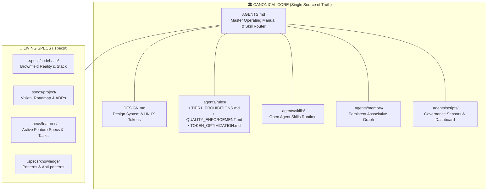
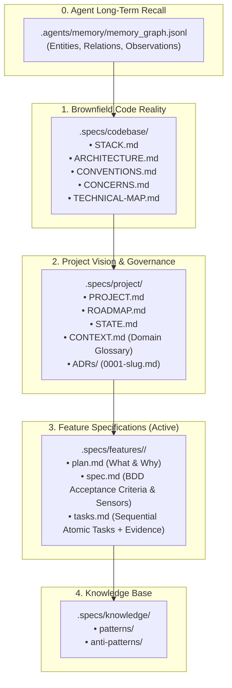
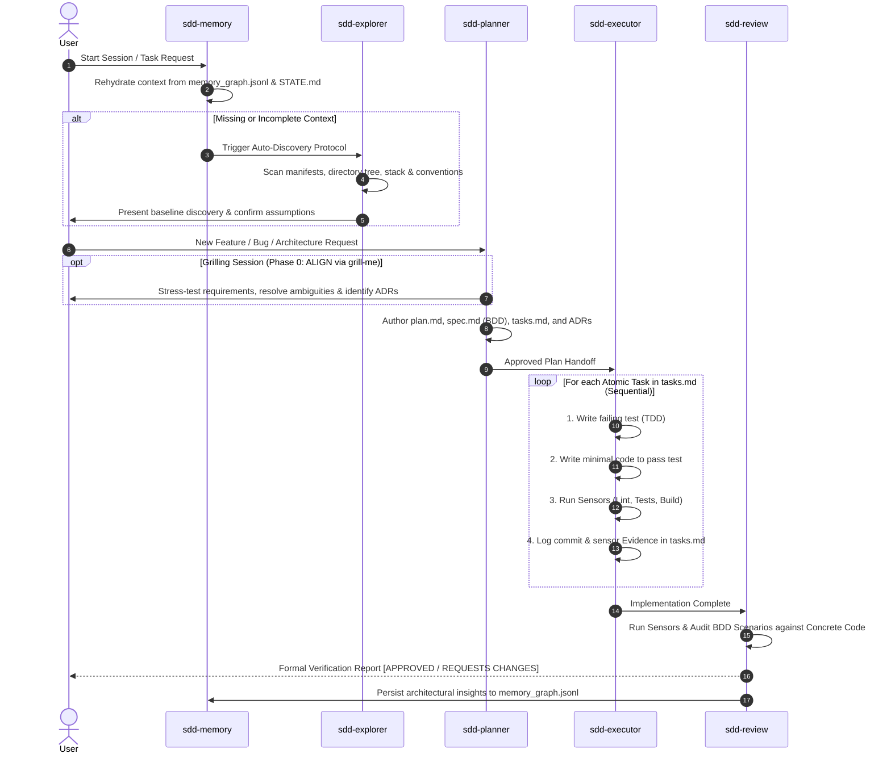

# AI-SDD Framework

> **Spec Driven Development (SDD) Lifecycle, Universal AI Agent Governance & Multi-Harness Skill Runtime**

[](https://opensource.org/licenses/MIT)
[](#-architecture--artifact-topology)
[](#-canonical-governance--standards)
[](#-the-sdd-lifecycle-protocol)
[](DESIGN.md)

---

## 🎯 Overview

**AI-SDD Framework** is an enterprise-grade agentic operating system and governance standard designed to eliminate the fundamental failure modes of AI coding assistants:
- ❌ Hallucinated architectures and broken dependencies.
- ❌ Unverified assumptions and silent code simplification (`// TODO`, stubs, deleted error handling).
- ❌ Context drift across multi-turn sessions and lost decisions.
- ❌ Bypassed test suites (`.skip()`, commented-out assertions, `--no-verify`).
- ❌ Lock-in to proprietary agent ecosystems.

Instead of unconstrained "prompt-and-code" execution, the framework enforces a **strict, deterministic Spec Driven Development lifecycle** governed by file-based persistent state, empirical sensor validation, and open skill standards.

```text
0. sdd-memory   ──► 1. sdd-explorer ──► 2. sdd-planner ──► 3. sdd-executor ──► 4. sdd-review
(Long-Term Recall)  (Brownfield Reality) (Specs & ADRs)     (Atomic TDD Cycle)   (Sensor Audit)
```

---

## 🏛️ Canonical Governance & Standards (AGENTS.md & DESIGN.md)

AI-SDD Framework is **100% harness-agnostic** and operates on a **File-First Single Source of Truth**: all state lives in standard Markdown, JSON Lines, and Mermaid diagrams. 

Rather than maintaining fragmented, tool-specific configuration files, governance, lifecycle enforcement, and UI standards are consolidated into three canonical foundations:

1. **`AGENTS.md`**: Master Operating Manual, Blocking Gates, Execution Rules, and Skill Routing Matrix across all AI agents and assistants.
2. **`DESIGN.md`**: Design tokens, color palettes, typography scales, and UI/UX invariant constraints.
3. **`.agents/`**: Core governance runtime comprising system rules (`.agents/rules/`), persistent memory graph (`.agents/memory/`), automation scripts (`.agents/scripts/`), and specialized skills (`.agents/skills/`).



---

## 🏛️ Architecture & Artifact Topology

The framework strictly partitions project state across 5 distinct, decoupled layers:



---

## 🔄 The SDD Lifecycle Protocol



---

## 🎛️ Complete Skills & Capabilities Matrix

All skills follow the **Open Agent Skills Standard** with structured YAML frontmatter, execution workflows, and reference templates:

| Skill | Category | Primary Purpose | Key Artifacts |
| :--- | :--- | :--- | :--- |
| **`sdd-memory`** | `project-codebase-memory` | Cross-session long-term recall & entity graph management | `.agents/memory/memory_graph.jsonl` |
| **`sdd-explorer`** | `project-mapping` | Brownfield discovery, stack mapping & conventions extraction | `.specs/codebase/` (`STACK.md`, `ARCHITECTURE.md`, `CONVENTIONS.md`, `TECHNICAL-MAP.md`) |
| **`sdd-planner`** | `project-planning` | Problem decomposition, BDD specs, atomic tasks & ADR authoring | `.specs/features/<id>/` (`plan.md`, `spec.md`, `tasks.md`), `.specs/project/` |
| **`grill-me`** | `requirement-analysis` | Relentless interview protocol to stress-test requirements (Phase 0) | Direct Q&A → Feeds `sdd-planner` & `CONTEXT.md` |
| **`sdd-executor`** | `development-workflow` | Surgical TDD implementation with sensor evidence & Safety Valve | Source code, test files, `tasks.md` (Evidence column) |
| **`sdd-review`** | `development-workflow` | Sensor-based empirical audit against BDD acceptance criteria | Formal Verification Report with Verdict in chat |
| **`debug`** | `diagnostics` | Zero-guesswork root cause analysis and reproduction | Diagnostic analysis → Feeds `sdd-planner` if replan needed |
| **`refactor`** | `code-quality` | Clean-code transformations with continuous non-regression test sensors | Refactored source code |
| **`search`** | `discovery` | Static symbol lookup, regex search, and call-site tracing | Direct `file:///` line references |
| **`arxiv`** | `research` | Academic paper search, abstract extraction & BibTeX generation | Paper summaries & BibTeX citations |
| **`write-a-skill`** | `meta-skill` | Authoring new agent skills with standard structure and resources | `.agents/skills/<skill-name>/SKILL.md` |

---

## 🛡️ Core Rules & Safety Valves

1. **Research Before Implementing (Zero Guesswork — Tier 1)**:
   > *"Source X does Y at file:line, we do Z, the difference causes W"* is the mandatory threshold. Hypothesizing or blind trial-and-error is rejected.
2. **Zero Shortcuts, Stubs or Simplified Code (Tier 1)**:
   `// TODO`, `// FIXME`, `/* stub */` or simplified mock algorithms are strictly prohibited. Response time is irrelevant — quality and correctness are absolute.
3. **No Test or Hook Bypassing ([QUALITY_ENFORCEMENT.md](.agents/rules/QUALITY_ENFORCEMENT.md))**:
   Never use `.skip()`, `.only()`, `--no-verify`, or `@ts-ignore` to hide failing tests.
4. **Safety Valve Protocol**:
   If an implementation task touches >3 files unexpectedly or hits high-risk legacy boundaries, the executor immediately halts and requests replanning from `sdd-planner`.
5. **Governed Deletions & Git Safety**:
   Destructive git operations (`git reset --hard`, `git push -f`, branch deletions) and project file removals are strictly blocked without human authorization.
6. **Design System Invariance**:
   All frontend and UI components must strictly inherit tokens (colors, typography, spacing, border radii) from [`DESIGN.md`](DESIGN.md).

---

## 📁 Repository Structure

```
ai-sdd-framework/
├── .agents/
│   ├── dashboard/dist/                 # Pre-compiled production Vue 3 Cockpit SPA assets
│   ├── memory/
│   │   └── memory_graph.jsonl          # Cross-session persistent knowledge graph
│   ├── rules/                          # Non-negotiable system rules (Highest Precedence)
│   │   ├── TIER1_PROHIBITIONS.md       # Prohibitions: No shortcuts, No destructive git, Sequential order, ACI, Test & ADR Immutability
│   │   ├── QUALITY_ENFORCEMENT.md      # Test & hook bypass bans, scratchpad isolation, Spec Drift invariance
│   │   └── TOKEN_OPTIMIZATION.md       # Calibrated output verbosity per model tier
│   ├── scripts/                        # Governance, server & sensor scripts (Zero-Dependency)
│   │   ├── serve-dashboard.js          # Native HTTP & RFC 6455 WebSocket gateway & 360° Living Specs API
│   │   ├── export-docs.js              # Standalone single-file HTML documentation compiler
│   │   ├── verify-sdd-integrity.js     # SDD Canonical Integrity & Schema Sensor (with --bootstrap & DAG checks)
│   │   ├── check-spec-drift.js         # Spec Drift Sensor with working-tree & glob matching
│   │   ├── compact-memory.js           # Memory graph maintenance & compaction
│   │   ├── install-hooks.js            # Worktree-resilient dual-sensor pre-commit hook installer
│   │   ├── auto-discover.js            # Deterministic project stack detection & codebase specs generator
│   │   ├── create-feature.js           # Canonical feature scaffolder (plan, spec, 7-column tasks)
│   │   └── run-sdd-review.js           # Unified Reviewer sensor gate & Verification Report compiler
│   └── skills/                         # Specialized Agent Skills & Protocols (Open Format)
│       ├── sdd-memory/                 # Long-term recall & graph maintenance
│       ├── sdd-explorer/               # Codebase discovery & technical mapping
│       ├── sdd-planner/                # Problem decomposition, specs & ADR authoring
│       ├── sdd-executor/               # Atomic TDD implementation with sensor evidence
│       ├── sdd-review/                 # Sensor-based empirical verification & scoring
│       ├── grill-me/                   # Interactive decision tree stress-testing (Phase 0)
│       ├── debug/                      # Root cause analysis & reproduction
│       ├── refactor/                   # Clean-code structural improvements
│       ├── search/                     # Targeted symbol, regex & pattern lookup
│       ├── arxiv/                      # Academic paper extraction & BibTeX generation
│       └── write-a-skill/              # Meta-skill for authoring new agent skills
├── .specs/                             # Living Specifications (Created per project)
│   ├── codebase/                       # Physical code architecture & stack maps (STACK, ARCHITECTURE, CONVENTIONS, CONCERNS, TECHNICAL-MAP)
│   ├── project/                        # Product vision, roadmap, session state & ADRs (PROJECT, ROADMAP, STATE, CONTEXT, ADRs/)
│   ├── features/                       # Active feature specifications (core-sensors-and-automation, enhanced-spec-cascade)
│   └── knowledge/                      # Curated patterns and anti-patterns
├── docs/                               # Exported Standalone Living Documentation
│   └── index.html                      # Single-file offline documentation (100% serverless)
├── packages/
│   └── dashboard/                      # Modular Vue 3 + Vite + Tailwind source code for Cockpit UI
├── tests/
│   ├── serve-dashboard.test.js         # Server & Living Docs API test suite (19 unit & integration tests)
│   ├── export-docs.test.js             # Standalone static exporter test suite (2 tests)
│   ├── core-sensors-automation.test.js # Sensors robustness & CLI automation test suite (8 tests)
│   └── installer.test.js               # One-Liner Installer & Update-Safe test suite (4 tests)
├── .cursorrules                        # Universal Cursor AI directive referencing AGENTS.md
├── .windsurfrules                      # Universal Windsurf AI directive referencing AGENTS.md
├── .clinerules                         # Universal Cline / RooCode directive referencing AGENTS.md
├── .github/
│   └── copilot-instructions.md         # GitHub Copilot instructions referencing AGENTS.md
├── AGENTS.md                           # 🏛️ Master Operating Manual & Skill Routing Matrix
├── DESIGN.md                           # 🎨 Linear-inspired Design Tokens & UI Specification
├── setup.ps1                           # 🚀 Windows PowerShell Universal One-Liner Installer
├── setup.sh                            # 🚀 POSIX Bash Universal One-Liner Installer
└── README.md                           # Official Documentation
```

---

## 🚀 Quickstart: Bootstrapping Any Project

You **never need to manually copy and paste folders or markdown files**. You can bootstrap or update the AI-SDD Framework in any repository (new or existing) with a single command pulled directly from GitHub.

### 1. One-Liner Bootstrap (Universal GitHub Archive)

Open your terminal in your project's root directory and run:

#### Windows (PowerShell):
```powershell
irm https://raw.githubusercontent.com/KlebersonCollab/ai-sdd-framework/main/setup.ps1 | iex
```

#### Linux / macOS / WSL / Git Bash:
```bash
curl -fsSL https://raw.githubusercontent.com/KlebersonCollab/ai-sdd-framework/main/setup.sh | bash
```

> **Zero Host Pollution**: The target project requires **zero npm dependencies**. The runtime sensors (`verify-sdd-integrity.js`, `check-spec-drift.js`) and the Cockpit server (`serve-dashboard.js`) run purely on native Node.js standard libraries (`http`, `fs`, `crypto`, `child_process`). Requires only Node.js (v18+) and Git.

---

### 2. Supported Workflows

#### 🟢 Scenario A: New Project from Scratch (Greenfield)
1. Create and enter your empty project directory:
   ```bash
   mkdir my-new-app && cd my-new-app
   ```
2. Run the one-liner command above.
3. The installer automatically:
   - Initializes Git (`git init`) if not already present.
   - Extracts the core governance engine (`.agents/`, `AGENTS.md`, `DESIGN.md`, `.cursorrules`, `.windsurfrules`, `.clinerules`).
   - Runs `verify-sdd-integrity.js --bootstrap` to scaffold the canonical living specification skeleton in `.specs/`.
   - Installs pre-commit drift and integrity hooks in `.git/hooks/pre-commit`.
4. Open your AI coding assistant (Antigravity, Cursor, Windsurf, Claude Code, Cline, Copilot) and start planning your first feature!

#### 🟡 Scenario B: Existing Project in Any Language (Brownfield)
*Works seamlessly with Node.js, Python, Rust, Go, Java, C#, PHP, Ruby, etc.*

1. Open your terminal in the root of your existing project:
   ```bash
   cd /path/to/my-existing-project
   ```
2. Run the one-liner command.
3. The installer detects existing manifest files (`package.json`, `Cargo.toml`, `pyproject.toml`, `go.mod`, `pom.xml`, etc.) and automatically:
   - Synchronizes `.agents/`, `AGENTS.md`, and agent directives.
   - Triggers the **Auto-Discovery Engine** (`auto-discover.js`), deterministically mapping your actual stack, test runners, folder organization, and conventions into `.specs/codebase/`.
   - Creates `.specs/project/CONTEXT.md` with your initial domain glossary.
   - Activates worktree-resilient git pre-commit hooks.
4. Your AI agent immediately has full context of your existing codebase without hallucination.

#### 🔄 Scenario C: Upgrading an Existing SDD Project (Update-Safe)
Whenever new sensors, Cockpit updates, or rule improvements are pushed to this repository:
1. Re-run the one-liner in your project directory at any time.
2. **Invariance Guarantee**: The installer **never overwrites** your existing business specs (`.specs/`) or your historical memory graph (`.agents/memory/memory_graph.jsonl`). It surgically upgrades the framework engine, scripts, and rules while keeping 100% of your project specifications intact.

---

### 3. Build Features with SDD (Elephant-Goldfish Model — EGM)
Once installed, interact with your AI assistant normally. For any new feature or refactor, request:
```text
"Planeje a feature de autenticação JWT com refresh token seguindo o SDD."
```
The agent executes the mandatory EGM lifecycle:
1. **`sdd-planner`** (with `grill-me` in Phase 0 Align) → scaffolds feature directory via `node .agents/scripts/create-feature.js <feature-id> --title "<Title>"`, drafting `plan.md`, `spec.md` with BDD scenarios, and atomic DAG-mapped `tasks.md`.
2. **`sdd-spec-review`** (The Goldfish Swarm) → runs cold adversarial spec review via `node .agents/scripts/run-spec-review.js <feature-id>` (or `npm run spec-review`) to catch unstated assumptions and ambiguous metrics before code is written.
3. **`sdd-executor`** → implements sequentially via TDD, logging sensor evidence and validating pre-commit file boundaries via `node .agents/scripts/check-spec-drift.js --working-tree`.
4. **`sdd-review`** → executes unified audit gate via `node .agents/scripts/run-sdd-review.js <feature-id>` (or `npm run review`), verifying sensors, test immutability, and running the deep **Semantic Spec Drift Engine** (`generate-drift-report.js` / `npm run drift-report`) to ensure 0 missing features, 0 incomplete models, and 0 logic shortcuts.

---

### 4. Interactive Human-AI Cockpit & Universal Living Docs
Launch the Cockpit web workspace (Vue 3 SPA + Embedded Terminal):

```bash
node .agents/scripts/serve-dashboard.js
```

Open [http://localhost:3000](http://localhost:3000) to access:

- **📚 Universal Living HTML Documentation (360° Specs Projection)**:
  - **🏛️ Architecture & System Map**: Renders `STACK.md`, `ARCHITECTURE.md`, `CONVENTIONS.md`, and **dynamic in-browser Mermaid diagrams** from ````mermaid code blocks.
  - **📜 ADR Decision Hub**: Interactive timeline of all Architectural Decision Records with status filtering (`Accepted`, `Superseded`, `Proposed`) and cross-impact tracking.
  - **📖 Domain & Vision**: Instant search across ubiquitous domain terms in `CONTEXT.md`, executive vision (`PROJECT.md`), and strategic milestones (`ROADMAP.md`).
  - **🛡️ Governance & Rules**: Visual reference for Tier 1 Absolute Prohibitions, Quality Enforcement, and Token Optimization.
  - **🧠 Knowledge Base**: Curated architectural patterns and anti-patterns.
- **⚡ Unified Spec Execution Cascade (ADR 0005)**:
  - **Hierarchical Vertical Cascade**: Connects Problem Statements (`plan.md`) to User Stories & BDD Scenarios (`spec.md`) and MetaGPT 7-Column Task Matrices (`tasks.md`).
  - **Topological DAG Dependency Resolution**: Real-time evaluation of task dependencies (`Depends On`), labeling tasks as Ready vs. Blocked (`🔒 Bloqueada`) with tooltips.
  - **Next Actionable Task Badge**: Automatically identifies and highlights the first unblocked task with a pulse badge (`⚡ PRÓXIMA / NEXT ACTIONABLE`).
  - **Inline Agent Dispatcher & Rejection**: 1-click `[⚡ Delegar]` button that generates and copies context-rich agent prompts, and `[↩ Rejeitar]` to send tasks back with recorded Markdown feedback.
  - **Interactive Dependency Badges**: Clickable dependency tags (green check `✓` or amber circle `○`) that immediately scroll to and highlight target tasks.
  - **Two-Way Git Sync**: Live bidirectional sync with physical `.specs/features/<id>/tasks.md` via Server-Sent Events (SSE).
- **🧠 Interactive Memory Graph**:
  - Force-directed network diagram (`vis-network`) visualizing all entities, relationships, and observations from `memory_graph.jsonl` with an interactive side inspector drawer.
- **💻 Embedded Terminal Drawer (`xterm.js`)**:
  - Openable via header badge or shortcut (`Ctrl+\`` / `Cmd+\``).
  - Connected to native PowerShell on Windows (with UTF-8 Nerd Font rendering) or Bash on POSIX.
  - Interactive line discipline with real-time typing echo, Backspace, command history (↑ / ↓), and 1-click sensor buttons (`[🔍 Drift Check]`, `[🧪 npm test]`).

### 5. Standalone Zero-Server Documentation Export
Compile the entire specification and governance tree into a standalone, single-file HTML document for offline review or static hosting (e.g. GitHub Pages):

```bash
npm run docs:export
```
Emits **`docs/index.html`** (~85 KB) with embedded CSS, client-side search, tabs, and rendered Mermaid diagrams—100% functional offline without Node.js.

### Useful Framework Scripts

| Command | Purpose |
| :--- | :--- |
| `npm run dashboard` | Starts the native Cockpit server on port 3000 with real-time SSE live-sync |
| `npm test` | Runs the 29-test sensor suite preceded by the SDD Canonical Integrity Sensor |
| `npm run verify-sdd` | Fast (<50ms) sensor auditing required canonical files, ADR statuses, schemas, and DAG acyclicity |
| `npm run check-drift` | Pre-commit Spec Drift Sensor validating working tree or staged git code against active `tasks.md` |
| `npm run auto-discover` | Deterministic brownfield stack scanner producing `.specs/codebase/` and `.specs/project/CONTEXT.md` |
| `npm run create-feature <id>` | Scaffolds canonical `.specs/features/<id>/` (`plan.md`, `spec.md`, 7-column `tasks.md`) |
| `npm run review <id>` | Unified Reviewer gate executing all 4 sensors, diff immutability check, and generating Verification Report |
| `npm run install-hooks` | Installs worktree-resilient dual-sensor pre-commit hook (`verify-sdd` + `check-drift`) |
| `npm run docs:export` | Compiles 100% of `.specs/` and rules into a standalone offline `docs/index.html` |
| `npm run compact-memory` | Compacts and resolves superseded entities in `memory_graph.jsonl` |
| `npm run build:dashboard` | Recompiles the Vue 3 frontend from `packages/dashboard/` into `.agents/dashboard/dist/` |

---

## 📄 License

This project is licensed under the [MIT License](LICENSE).

